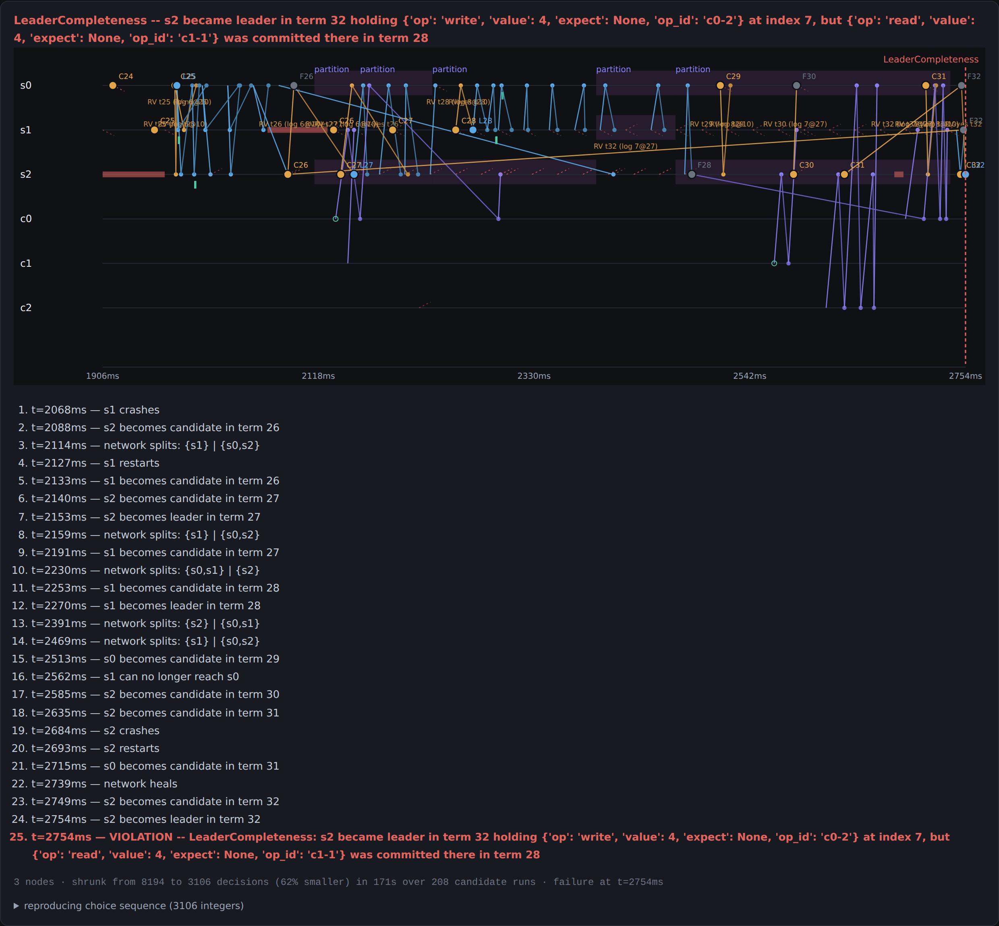

# counterexample

**A deterministic simulator that hunts for the exact schedule of message delays,
crashes and partitions that breaks a consensus algorithm — then shrinks it until
a human can read it.**

Distributed-systems bugs are not bugs in the code so much as bugs in the
*ordering*. The implementation is fine for every schedule you happened to run
and wrong for one you didn't. Worse, when you finally hit it, you get a failure
you cannot reproduce: a stack trace, a timestamp, and "it happens about once
every few thousand runs."

So this replaces the source of nondeterminism entirely. Nothing here touches
wall-clock time, threads, sockets or `random`. Every nondeterministic decision a
run makes — how long this message takes, whether it is dropped, when this
election timer fires, whether to crash a node right now, even how many nodes
there are — is drawn from a **choice sequence**: a plain list of small integers.

That one decision buys three things:

- a run is a **pure function of a list of integers**, so a failure reproduces
  exactly, on any machine, forever;
- failures can be **shrunk mechanically** — delete a span of integers, re-run,
  did it still fail? — with a shrinker that knows nothing about Raft;
- the shrinking has a **direction**, because zero means "nothing unusual
  happened", so *making the numbers smaller* is the same thing as *making the
  run calmer*.

On top of that sits a real Raft implementation with eight deliberately seeded
defects, six safety invariants, a linearizability checker, and three search
strategies competing to find the schedules that break it.

<p align="center">
  
</p>

<p align="center"><em>A seeded defect, found automatically, minimised from 8,194
scheduling decisions to 3,106, and rendered as a 25-step story ending in the
exact moment Leader Completeness broke. The choice sequence under it replays
that failure on any machine.</em></p>

---

## The result that matters most

Before any bug-finding number means anything, the checkers have to be trusted.
So the first thing the experiment does is point all three searches at the
**unmodified** implementation and try to break it:

| search | schedules | false positives |
|---|---|---|
| `random` | 1,000 | **0** |
| `coverage` | 1,000 | **0** |
| `bandit` | 1,000 | **0** |

3,000 adversarial schedules against correct Raft, zero reported violations. Any
number other than zero there would make everything below meaningless — which is
not a hypothetical, because **the first two versions of this were wrong, and the
tool caught both.** ([below](#the-two-bugs-the-tool-found-in-itself).)

## Finding the seeded defects

Eight defects, each a real mistake people make implementing Raft, each a single
guard in one shared implementation:

```python
if "no_log_up_to_date_check" not in self.bugs:
    ...the correct check...
```

Trials until the first violation, budget 300, six independent seeds per cell:

| seeded defect | `random` | `coverage` | `bandit` | caught by |
|---|---|---|---|---|
| `commit_index_unclamped` | 6/6, med 1 | 6/6, med 1 | 6/6, med 1 | CommitIndexInBounds |
| `no_log_up_to_date_check` | 6/6, med 1 | 6/6, med 1 | 6/6, med 1 | LeaderCompleteness |
| `truncate_on_every_append` | 6/6, med 2.5 | 6/6, med 3.5 | 6/6, med 4 | LeaderCompleteness |
| `ignore_prev_log_term` | 6/6, med 5.5 | 6/6, med 14.5 | 6/6, med 10 | StateMachineSafety |
| `accept_stale_term` | 6/6, med 9.5 | 6/6, med 21 | 6/6, med 13.5 | LeaderAppendOnly |
| `no_step_down_on_higher_term` | — | — | — | *(see below)* |
| `no_persist_voted_for` | — | 1/6, med 137 | — | ElectionSafety |
| `commit_any_term` | 1/6, med 164 | — | 1/6, med 40 | LeaderCompleteness |

Five of eight fall over almost immediately. Three need a specific interleaving
that a random schedule reaches roughly never, so calling them "not found" at 300
trials would be an underpowered experiment dressed up as a result. They get
1,000 trials each instead:

| defect | seeds | `random` | `coverage` | `bandit` |
|---|---|---|---|---|
| `commit_any_term` (Raft's Figure 8) | 5 | 2/5, med 407 | 1/5, med 567 | 2/5, med 414 |
| `no_step_down_on_higher_term` | 2 | 0/2 | 1/2, med 365 | 0/2 |
| `no_persist_voted_for` | 2 | 0/2 | 0/2 | 0/2 |

## The negative result, stated plainly

**Coverage-guided search does not beat random search here, and the bandit does
not beat coverage.** On the easy defects random is consistently *fastest* —
mutating a corpus is pure overhead when the bug fires on most schedules anyway.
On the hard ones, nothing separates the three.

It is worth saying how close this came to reading the other way. At two seeds,
the Figure 8 result was **bandit 2/2, coverage 1/2, random 0/2** — a clean,
publishable-looking win for the learned search, and exactly the table I wanted.
Widening to five seeds turned it into 2/5, 1/5, 2/5. The effect was noise, and
two samples was not enough to see that.

That is the honest finding, and it is the more useful one: the value in this
project is the deterministic simulator and the shrinker, not the clever search
sitting on top. A generic coverage signal over cluster states — role mix, nodes
down, partition shape, how far the replicas' terms and logs have drifted — does
not appear to know anything random sampling doesn't. Making it work would
probably need a signal that understands *why* an interleaving is rare, and that
is [future work](#future-work), not a claim.

## Shrinking

Every failure arrives as thousands of scheduling decisions. Delta debugging cuts
it to the ones that mattered:

| seeded defect | property | before | after | reduction |
|---|---|---|---|---|
| `commit_index_unclamped` | CommitIndexInBounds | 5,787 | **267** | 95% |
| `no_log_up_to_date_check` | LeaderCompleteness | 7,439 | **415** | 94% |
| `ignore_prev_log_term` | StateMachineSafety | 5,551 | **895** | 84% |
| `no_persist_voted_for` | ElectionSafety | 5,068 | **1,548** | 69% |
| `accept_stale_term` | StateMachineSafety | 9,708 | **2,828** | 71% |
| `truncate_on_every_append` | LeaderCompleteness | 12,611 | **3,651** | 71% |
| `no_step_down_on_higher_term` | LeaderAppendOnly | 7,967 | **2,959** | 63% |
| `commit_any_term` | LeaderCompleteness | 8,194 | **3,106** | 62% |

Every one of those still reproduces its original violation exactly. Each is
capped at about 150 seconds of shrinking, so these are time-bound, not
converged — the 62% rows would keep falling given longer.

What comes out the other end is a story, not a log:

```
$ python -m cx hunt --bugs truncate_on_every_append --budget 60

FOUND after 11 schedules: LeaderCompleteness: s2 became leader in term 35
  without entry 19, which was committed in term 32
choice sequence: 4432 decisions
shrunk to 397 decisions in 25.0s (2713 candidate runs)

--- minimal counterexample (3 nodes) ---
  t=72     s2 becomes candidate in term 1
  t=111    s0 becomes candidate in term 1
  t=126    s2 becomes candidate in term 2
  t=138    s2 becomes leader in term 2
  t=160    s2 applies index 1 (term 2): read(1) c2-1
  t=167    s1 applies index 1 (term 2): read(1) c2-1
  t=169    s0 applies index 1 (term 2): read(1) c2-1
  t=242    s2 applies index 2 (term 2): read(1) c2-2
  t=256    s2 crashes
  t=306    s0 becomes candidate in term 3
  t=347    s0 becomes leader in term 3
  t=347    VIOLATION -- LeaderCompleteness: s0 became leader in term 3 without
           entry 1, which was committed in term 2

reproduction written to repro.json
```

```
$ python -m cx replay repro.json      # same failure, any machine, forever
```

---

## The two bugs the tool found in itself

Pointing the search at the *correct* implementation was supposed to be a
formality. It failed twice, and both failures were in the checkers.

**Leader Completeness applied to the wrong leaders.** The first version compared
every leader against every committed entry. But under a partition, a stale
leader from an older term is still a leader, and it is *entitled* to a different
log — Leader Completeness constrains leaders of terms *later* than the one an
entry was committed in. Recording the term each entry was committed in, and only
checking leaders above it, fixed it.

**Liveness stated at the wrong level.** Version one asked "is there exactly one
leader when the run ends?" A healthy cluster is leaderless for a couple hundred
milliseconds every time an election runs, and whether the run ends during one is
luck. Version two asked "did a client operation complete after the network
healed?" — better, still brittle, because a client four hundred milliseconds
into a retry when the storm ends may legitimately not finish in the window. The
version that survives asks the cluster-level question — *did the commit index
advance* — and skips the check entirely unless the run actually reached the calm
period.

There was also a third, in the shrinker, and it is my favourite:

**`draw_bool` was backwards.** Written the obvious way, `draw(100) < percent`,
value 0 satisfies `0 < 4` — so zero meant *drop this message* and *make this
link slow*. Zeroing a span, the shrinker's single most useful move, turned the
network into a black hole instead of a quiet one, and every "minimised"
counterexample was a run shrunk toward losing everything. The fix is
`>= 100 - percent`: same probability, opposite end of the range. A three-line
test (`test_zero_means_nothing_unusual`) is the only reason it was found rather
than shipped.

## Running it

No dependencies. Python 3.8+.

```bash
python -m cx run                       # one simulated cluster under faults
python -m cx bugs                      # list the eight seeded defects
python -m cx hunt --bugs commit_any_term --budget 500 --save repro.json
python -m cx replay repro.json         # replay a saved failure exactly

make test        # 85 tests, ~45s
make bench       # the full experiment -> results/results.json
make report      # results/report.html + results/summary.md
```

`results/report.html` is a self-contained page: all eight minimised
counterexamples, each with its space-time diagram, its numbered story, and the
choice sequence that reproduces it.

## What is in here

```
cx/sim/          the deterministic world
  choices.py       the choice sequence -- the idea everything rests on
  world.py         virtual clock, event queue, hostile network, faults
  client.py        sequential clients, at-most-once ops, honest histories
  scenario.py      one experiment: build a cluster, torture it, check it
cx/raft/
  node.py          Raft + eight named defects, as guards in one implementation
  messages.py      the RPCs
cx/check/
  invariants.py    six safety properties, checked against the whole cluster
  linearizability.py  Wing & Gong with memoisation, indeterminate ops handled
cx/search/
  mutate.py        seven mutation operators over a list of integers
  fuzz.py          random / coverage-guided / UCB1 bandit
  shrink.py        delta debugging that preserves the *same* violation
cx/viz/
  spacetime.py     SVG space-time diagrams and the numbered story
cx/eval/run.py     the experiment
tests/             85 tests
```

The Raft implementation covers leader election with randomised timeouts, log
replication with the consistency check and conflict backtracking, persistence
across crashes, commitment by majority restricted to the current term, and a
replicated register with at-most-once client semantics. It does **not** cover
snapshots, log compaction, membership changes, pre-vote or leadership transfer —
those are absent rather than half-built, and the bugs that live there are out of
scope.

`docs/ARCHITECTURE.md` has the reasoning behind every design decision here,
including the ones that were wrong first.

## Limitations

- **No byzantine faults.** Nodes follow the code, correctly or with a seeded
  defect. No disk corruption, no partial writes, no message corruption.
- **One global clock.** Nodes cannot disagree about time, so clock-skew bugs are
  out of reach.
- **Simulated timing.** Nothing here says anything about real-world performance;
  every number is a counted event.
- **Shrinking minimises decisions, not duration.** A shrunk run can still
  simulate six seconds and commit two thousand entries — it just does so without
  anything unusual happening. Shrinking the *horizon* would need it to be drawn
  from the choice stream too.
- **Small samples on the rare defects.** Two to five seeds at 1,000 trials.
  Enough to show the searches are not clearly different, not enough to prove
  they are the same.
- **Eight defects is a small benchmark**, and they are defects I chose, which
  is a bias no amount of methodology removes.

## Future work

- **A coverage signal that understands rarity**, rather than counting cluster
  states. The current one is generic by design — a metric tuned to the defects
  it is meant to find would make the comparison meaningless — but generic
  appears to mean uninformative here.
- **Partial-order reduction**, so schedules that differ only in the order of
  independent events are not explored twice. This is the standard answer to
  exactly the problem the searches are failing at.
- **Byzantine and disk faults**, which is where the interesting unmodelled bugs
  are.
- **A second algorithm** — Viewstamped Replication or Paxos — to check that the
  harness is testing consensus rather than testing this Raft.
- **Shrinking the horizon**, so a minimal counterexample is short in simulated
  time as well as in decisions.

## Prior art

Deterministic simulation testing is FoundationDB's idea, and the best public
account of it is their "Testing Distributed Systems w/ Deterministic Simulation"
talk. Choice-sequence shrinking is Hypothesis's internal representation. The
linearizability checker is Wing & Gong's algorithm in the linked-list
formulation Lowe describes, the same approach Knossos and Porcupine take. Jepsen
established that the interesting question about a distributed system is what it
does under partition.

What this puts together is the combination: a simulator whose entire
nondeterminism is one list of integers, a shrinker that exploits that without
knowing what the integers mean, a ground-truth benchmark of seeded defects to
measure the search against, and the discipline of validating the checkers
against a correct implementation first.

## License

MIT.
